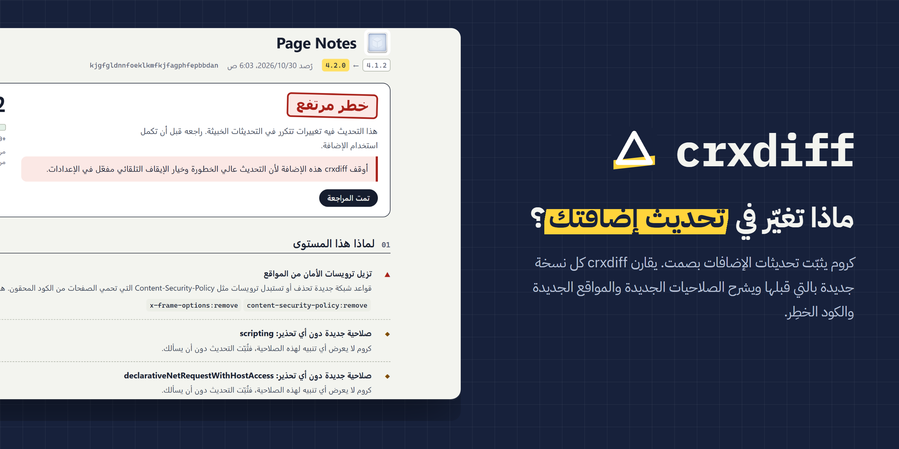
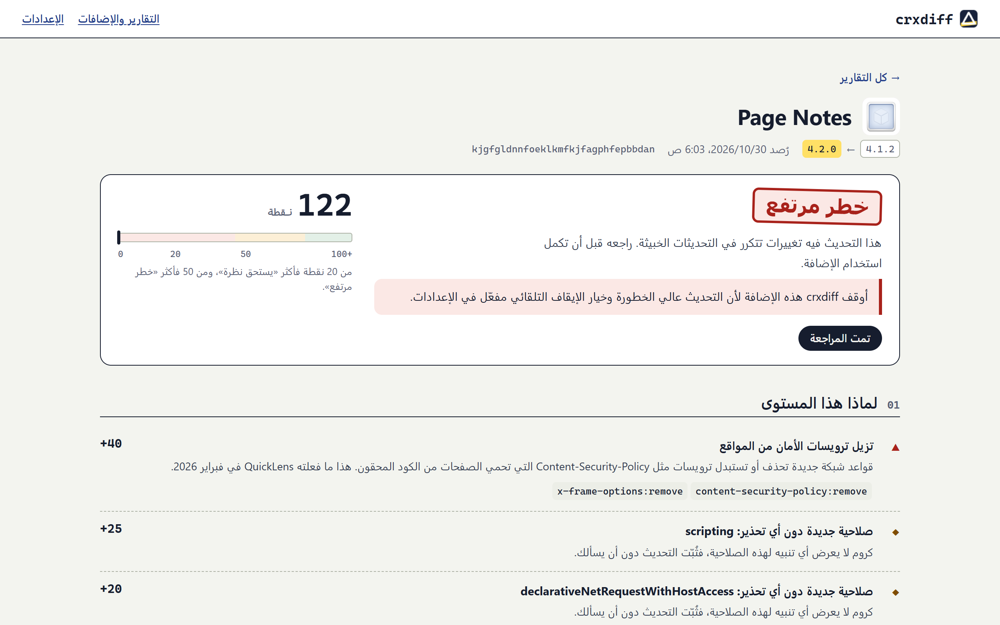
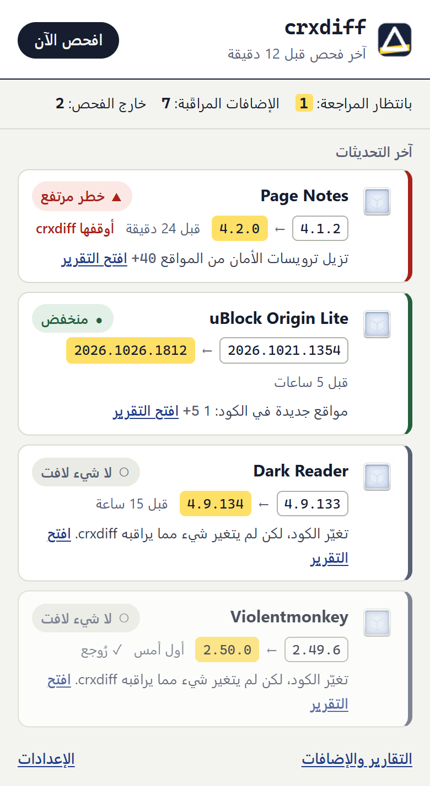
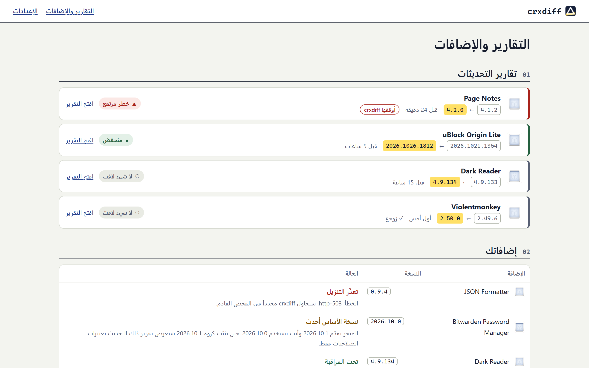

<div dir="rtl">

<p align="center">
  
</p>

<p align="center">
  <a href="https://github.com/yahyakhalid/crxdiff/actions/workflows/ci.yml"></a>
  <a href="LICENSE"></a>
  
  
</p>

<p align="center"><a href="README.md">English</a> · <b>العربية</b></p>

<p align="center">
  <a href="https://github.com/topics/chrome-extension"><code>#chrome-extension</code></a>
  <a href="https://github.com/topics/browser-extension"><code>#browser-extension</code></a>
  <a href="https://github.com/topics/manifest-v3"><code>#manifest-v3</code></a>
  <a href="https://github.com/topics/supply-chain-security"><code>#supply-chain-security</code></a>
  <a href="https://github.com/topics/security"><code>#security</code></a>
  <a href="https://github.com/topics/privacy"><code>#privacy</code></a>
  <a href="https://github.com/topics/malware-detection"><code>#malware-detection</code></a>
  <a href="https://github.com/topics/diff"><code>#diff</code></a>
  <a href="https://github.com/topics/crx"><code>#crx</code></a>
  <a href="https://github.com/topics/permissions"><code>#permissions</code></a>
  <a href="https://github.com/topics/local-first"><code>#local-first</code></a>
  <a href="https://github.com/topics/rtl"><code>#rtl</code></a>
  <a href="https://github.com/topics/arabic"><code>#arabic</code></a>
</p>

# crxdiff

**ماذا تغيّر في هذا التحديث؟ يخبرك crxdiff بذلك عن كل إضافة مثبّتة في كروم: الصلاحيات الجديدة (ومنها التي لا يحذّر منها كروم أبداً)، والمواقع الجديدة في الكود، وحذف ترويسات الأمان، والكود الخطِر. وكل المقارنة تجري على جهازك.**

## المشكلة

إضافات كروم تحدّث نفسها بصمت. لا يوقف كروم التحديث إلا إذا أضاف صلاحية يظهر لها [تحذير](https://developer.chrome.com/docs/extensions/develop/concepts/permission-warnings)، وعندها تبقى الإضافة متوقفة حتى يوافق المستخدم على الصلاحية الجديدة. أما غير ذلك، ومنه الكود الجديد داخل صلاحيات تملكها الإضافة أصلاً، فيُثبَّت دون كلمة.

وبهذه الطريقة وصلت أغلب الحوادث الأخيرة إلى الناس:

- **Cyberhaven، ديسمبر 2024.** اختُرق حساب المطوّر بالتصيّد ونُشرت نسخة خبيثة رقمها 24.10.4، وطالت الحملة نفسها إضافات كثيرة أخرى ([RH-ISAC](https://rhisac.org/threat-intelligence/cyberhaven-extension-compromise-part-of-broader-campaign-affecting-multiple-chrome-extensions/)).
- **RedDirection، يوليو 2025.** وصل الكود الخبيث إلى 18 إضافة يستخدمها أكثر من 2.3 مليون شخص عبر تحديثات لاحقة، وبعضها كان موثّقاً أو مميّزاً في المتجر ([Infosecurity Magazine](https://www.infosecurity-magazine.com/news/18-malicious-chrome-edge-extensions/)).
- **ShadyPanda، أواخر 2025.** إضافات تعمل بشكل طبيعي منذ 2018 جاءها تحديث في منتصف 2024 صار يحمّل كود JavaScript عشوائياً كل ساعة، ومجموع مستخدميها نحو 4.3 مليون ([Infosecurity Magazine](https://infosecurity-magazine.com/news/shadypanda-infects-43m-chrome-edge)).
- **QuickLens، فبراير 2026.** عُرضت للبيع ثم انتقلت إلى مالك جديد، فنزل تحديث يحذف ترويسات الأمان ويحمّل JavaScript من خادم بعيد كل خمس دقائق ([The Hacker News](https://thehackernews.com/2026/03/chrome-extension-turns-malicious-after.html)).
- **«Save image as Type»، مطلع 2026.** تجاوز مستخدموها المليون وحملت شارة Featured، وبعد انتقال ملكيتها صارت تختطف روابط الإحالة ([PCWorld](https://www.pcworld.com/article/3092299/my-most-useful-chrome-extension-was-stealing-my-data-for-years.html)).
- **JSON Formatter، 2026.** أُغلق مصدرها وصارت تحقن عنصر تبرعات في صفحات الدفع وتتصل بخوادم جديدة، مع أن المقال نفسه يقول إن دليل الاحتيال غير قاطع ([DEV](https://dev.to/pavkode/json-formatter-extension-turns-closed-source-introduces-intrusive-donation-tactics-and-tracking-kf8)).

كل واحدة منها كانت تحديثاً لم يره المستخدم.

## لمن هذه الإضافة

- **لمن يستخدم أكثر من بضع إضافات** ويريد أن يعرف حين تتغير إحداها تغييراً يستحق الانتباه.
- **للمطوّرين وفرق تقنية المعلومات الصغيرة** التي لا تبرّر شراء منصة مؤسسية لأمان الإضافات، وتريد أكثر من رسالة «تم التحديث».

## ماذا تفعل

| | |
|---|---|
| **نسخة أساس** | في أول تشغيل تنزّل كل إضافة مثبّتة من المتجر عبر خادم التحديث التابع لـ Google وتحفظ ملخصاً عنها: manifest، وأحجام الملفات وبصماتها (SHA-256)، والمواقع المذكورة في الكود، والأنماط الخطِرة. لا تحفظ الكود المصدري. |
| **رصد التحديثات** | تستمع إلى `chrome.management.onInstalled` وتفحص أيضاً كل 1 إلى 24 ساعة، فلا يفوتها تحديث حتى لو ضاع الحدث. |
| **تقرير «ماذا تغيّر»** | الصلاحيات الجديدة والمحذوفة (مع علامة على ما لا يحذّر منه كروم)، والوصول الجديد إلى المواقع وأماكن عمل سكربتات المحتوى، وتغييرات CSP، والمواقع الجديدة في الكود، وأول ظهور لـ `eval` و`new Function` والسكربتات البعيدة و`executeScript`، والقواعد التي تحذف `Content-Security-Policy` أو `X-Frame-Options`، والملفات المموّهة أو ملفات WebAssembly الجديدة، وحيل ملفات ZIP، وقفزات الحجم، وتغيّر رابط التحديث أو الموقع أو المؤلف. ومعها قائمة بالملفات ملفاً ملفاً وفرق `manifest.json`. |
| **درجة قابلة للتفسير** | لكل ملاحظة نقاطها وسببها بلغة واضحة. من 20 نقطة فأكثر «يستحق نظرة»، ومن 50 فأكثر «خطر مرتفع». |
| **إيقاف تلقائي اختياري** | توقف الإضافة إذا كان تحديثها عالي الخطورة، وتعيد تشغيلها بنقرة واحدة. الخيار معطّل افتراضياً. |
| **بلغتين** | الإنجليزية والعربية، مع واجهة كاملة من اليمين إلى اليسار. |
| **على جهازك فقط** | بلا خادم ولا حساب ولا تحليلات. الطلبات الوحيدة على الشبكة تذهب إلى خوادم التحديث التابعة لـ Google، لتنزيل إضافات مثبّتة عندك أصلاً. |

## لقطات الشاشة

صفحات الإضافة الحقيقية في Chrome for Testing، أما البيانات فمحاكاة: «Page Notes» إضافة مختلَقة من [`test/fixtures`](test/fixtures) نسختها 4.2.0 تقلّد ما فعلته QuickLens، وبقية التقارير مقارنات حقيقية بين إصدارات عامة متتالية.

<p align="center"></p>

<p align="center">
  
</p>

<p align="center"></p>

## التثبيت

crxdiff ليست في Chrome Web Store بعد، وسنضيف الرابط هنا حين تُنشر.

1. نزّل `crxdiff-0.1.0.zip` من [آخر إصدار](https://github.com/yahyakhalid/crxdiff/releases) وفك ضغطه، أو ابنِه بنفسك (الطريقة بالأسفل).
2. افتح `chrome://extensions`، وفعّل **وضع المطوّر** (Developer mode)، ثم اضغط **Load unpacked** واختر المجلد.
3. يبدأ crxdiff بحفظ نسخ الأساس فوراً. افتح نافذته من شريط الأدوات لترى الحالة.

البناء من المصدر (Node.js 20 أو أحدث):

<div dir="ltr">

```bash
git clone https://github.com/yahyakhalid/crxdiff
cd crxdiff
npm ci
npm run check     # lint, tests, then dist/crxdiff-0.1.0.zip
```

</div>

البناء حتمي: المصدر نفسه يعطي ملف zip نفسه بايتاً ببايت.

## كيف تعمل

1. **الجرد.** تعطي `chrome.management.getAll()` كل إضافة مثبّتة ونسختها وطريقة تثبيتها. الإضافات المحمّلة من مجلد، أو المثبّتة بسياسة مؤسسة، أو القادمة من متجر Edge، أو التي تتحدّث من خادمها الخاص، تظهر «خارج الفحص» مع السبب.
2. **التنزيل.** يعيد الرابط `https://clients2.google.com/service/update2/crx?response=redirect&…` الحزمة الحالية بعد تحويل إلى `clients2.googleusercontent.com`. ويتأكد crxdiff أن `crx_id` في ترويسة CRX3 هو نفسه معرّف الإضافة المطلوبة.
3. **فك الضغط بحذر.** يفرض قارئ ZIP الخاص بالإضافة الحدود قبل حجز أي ذاكرة (عدد الملفات، وحجم الملف الواحد والمجموع، ونسبة الضغط)، ويفك الضغط على خطوات من 8 كيلوبايت بمكتبة [fflate](https://github.com/101arrowz/fflate) المضمّنة، ويوقف أي ملف لحظة يتجاوز الحجم الذي أعلنه. لا يُكتب شيء على القرص ولا يُشغَّل أي كود.
4. **التلخيص.** بصمة SHA-256 لكل ملف، والمواقع من الروابط الكاملة في السكربتات والصفحات، وقائمة الأنماط الخطِرة، وقواعد `declarativeNetRequest` الثابتة التي تمس ترويسات الأمان، وفحص شكل الكود المضغوط والمموّه. وكل أدوات المسح تعمل في زمن خطّي.
5. **المقارنة.** يُقارن الملخص الجديد بنسخة الأساس (`src/lib/diff.js`)، وتأخذ كل ملاحظة نقاطها (`src/lib/risk.js`)، ويُحفظ التقرير محلياً.
6. **الإبلاغ.** رقم على أيقونة الإضافة للتقارير غير المراجَعة التي تستحق نظرة أو عالية الخطورة، وإشعار اختياري، وإيقاف تلقائي إن فعّلته.

المتجر يقدّم أحدث نسخة فقط، فقد لا تطابق نسخة الأساس الأولى ما هو مثبّت عندك. يسجّل crxdiff ذلك بأمانة: إذا كانت نسخة الأساس أحدث من نسختك يحتفظ بها، ويُعرض التحديث التالي بعنوان «الصلاحيات فقط»، وإذا كانت أقدم يتركها ويحاول لاحقاً. وإذا تعذّر تحليل حزمة جديدة (كبيرة جداً، أو تالفة، أو بطيئة جداً) يُعرض التحديث على أنه عالي الخطورة بدل أن يُتجاهل.

محرّك المقارنة وحدات ES عادية لا تعتمد على واجهات المتصفح، فيعمل في Node أيضاً:

<div dir="ltr">

```bash
node scripts/compare.mjs old.crx new.crx          # or .zip
```

</div>

## الخصوصية

- لا يخرج من متصفحك إلا طلبات التنزيل إلى `clients2.google.com` و`clients2.googleusercontent.com`، وفيها معرّف الإضافة ونسخة كروم، وهو الطلب نفسه الذي يرسله كروم ليتحقق من التحديثات.
- تُحفظ نسخ الأساس والتقارير في `chrome.storage.local`. وفي الإعدادات زر لتصديرها (JSON) وزر لحذفها كلها.
- لا تحليلات ولا قياس استخدام ولا كود بعيد. سياسة CSP في الإضافة لا تسمح إلا بسكربتاتها، ولا تتصل إلا بخادمَي التحديث.

السياسة كاملة: [PRIVACY.md](PRIVACY.md).

### الصلاحيات

| الصلاحية | السبب |
|---|---|
| `management` | لعرض إضافاتك ونسخها، ورصد تحديثاتها، وإيقاف إضافة (فقط إن فعّلت الإيقاف التلقائي) أو إعادة تشغيلها. |
| `storage` | لحفظ نسخ الأساس والتقارير والإعدادات على جهازك. |
| `alarms` | للفحص الدوري (كل 1 إلى 24 ساعة). |
| `notifications` | لإعلامك بتحديث يستحق نظرة (ويمكن إيقافها). |
| `https://clients2.google.com/*` و`https://clients2.googleusercontent.com/*` | لتنزيل حزم الإضافات المثبّتة عندك من خادم التحديث التابع لـ Google. |

لا تطلب الإضافة `unlimitedStorage`: الملخصات الحقيقية صغيرة (أكبرها في الاختبار uBlock Origin Lite بنحو 250 كيلوبايت)، والحزمة المبنية لملء التخزين تُرفض.

## مقارنة بالبدائل

| | تنظر في تغييرات الكود | الصلاحيات التي بلا تحذير | تعمل محلياً | لمن | الحالة (2026-10-29) |
|---|---|---|---|---|---|
| **crxdiff** | ✅ ملخص وقائمة ملفات وفرق manifest | ✅ | ✅ | كل من يستخدم إضافات | تجريبية 0.1 |
| [ext-watcher](https://github.com/ading2210/ext-watcher) | ✅ فرق كامل مع فك التمويه | عبر الفرق | ✅ (جهازك أو خادمك) | المطوّرون: سكربت Python لقائمة معرّفات يرسل الفروق إلى Discord عبر webhook | مفتوحة المصدر (AGPL-3.0) |
| [Under New Management](https://github.com/classvsoftware/under-new-management) | ❌ تغيّر المالك فقط | ❌ | ❌ تعتمد على API خارجي | الجميع | بلا تحديث منذ نحو سنتين ([Android Authority](https://www.androidauthority.com/chrome-extension-under-new-management-3650500/)) |
| [Extensions Update Tracker](https://github.com/maximtop/extensions-update-tracker) | ❌ سجل أرقام النسخ | ❌ | ✅ | الجميع | مفتوحة المصدر |
| [CRX Viewer](https://github.com/Rob--W/crxviewer) | ❌ تعرض نسخة واحدة | ❌ | ✅ | المطوّرون | مفتوحة المصدر |
| Secure Annex (Socket) وSpin.ai وLayerX وKoi | ✅ | ✅ | ❌ سحابية | الشركات | مدفوعة |

**أقرب بديل وظيفي هو ext-watcher**: ينزّل النسخ الجديدة للمعرّفات التي تحددها، ويفك تمويهها، ويولّد الفروق. إن كنت مرتاحاً لتشغيل مهمة Python وقراءة فروق الكود فهو يعرض من الكود أكثر مما يعرضه crxdiff. أما ما يميّز crxdiff فهو أنه يعمل داخل المتصفح ويراقب ما هو مثبّت فعلاً، ويشرح التغيير بلغة واضحة مع درجة، ويستطيع إيقاف الإضافة.

## نتائج مُتحقَّق منها

قيست في 2026-10-30 (Windows 11 وNode 26 وChrome for Testing 156.0.8078.80). طريقة إعادة كل قياس في [docs/experiment.md](docs/experiment.md).

| الفحص | النتيجة |
|---|---|
| التنزيل والتحليل داخل service worker الإضافة، 4 معرّفات حقيقية من المتجر | 4 من 4، و`crx_id` مطابق في كل مرة، ولا مشكلة CORS |
| هل يعمل `management.onInstalled` حين تتحدّث إضافة أخرى | نعم، بعد 7 إلى 8 ملّي ثانية من التحديث (إعادة تحميل إضافة من مجلد؛ لم يمكن اختبار تحديث حقيقي من المتجر) |
| التحديثات الروتينية: 26 إصداراً حقيقياً متتالياً لـ 6 إضافات شائعة | 24 «لا شيء لافت»، و2 «منخفض» (5 نقاط)، وصفر «يستحق نظرة»، وصفر «خطر مرتفع» |
| تحديث يحاكي QuickLens (`test/fixtures/page-notes-4.2.0`) | خطر مرتفع، 122 نقطة |
| زمن التحليل داخل service worker | من 53 ملّي ثانية (Dark Reader) إلى 1.3 ثانية (Bitwarden، 26 ميغابايت) |
| الاختبارات | 60 اختباراً ناجحاً (`npm test`) |
| حزمة المتجر | `dist/crxdiff-0.1.0.zip`، فيها 29 ملفاً، وقابلة لإعادة البناء بالبايت نفسه |

## الحدود

- **تجريبية (0.1).** ستتغير النقاط والعتبات كلما رأينا تحديثات حقيقية أكثر.
- **ترصد بعد أن يُثبَّت التحديث.** كروم يثبّت أولاً ثم يبلغ crxdiff (عادة خلال دقائق من الحدث، وأقصى تأخير هو فترة فحص واحدة). هي أداة رصد لا منع، إلا عبر الإيقاف التلقائي الاختياري.
- **الكود المموّه أو الضخم يحدّ مما تراه.** تنبّه إلى التمويه والملفات التي تعذّرت قراءتها، لكنها لا تعرف ما يفعله سكربت مموّه، ولا تجد اسم موقع يُبنى أثناء التشغيل (`'ht'+'tps://'…`) بالمسح النصي.
- **إضافات Chrome Web Store فقط.** إضافات متجر Edge، والمحمّلة من مجلد، والمثبّتة بسياسة مؤسسة، والتي تتحدّث من خادمها، تظهر خارج الفحص.
- **قد يكون أول تحديث بعد التثبيت «للصلاحيات فقط»** إن كان المتجر قد سبق نسختك حين أُخذت نسخة الأساس.
- **لم نتحقق من أن تحديثاً حقيقياً من المتجر يطلق `management.onInstalled`** (تحققنا من إعادة تحميل إضافة من مجلد فقط)، والفحص الدوري يغطي الحالتين على أي حال.
- **«المواقع المذكورة في الكود» ليست حركة شبكة.** ذكر الاسم لا يثبت أن الإضافة تتصل به، وقد يتصل الكود بمواقع لا يذكرها نصاً.

## الخطة القادمة

- دعم Firefox (AMO) ومتجر Microsoft Edge.
- عرض الفرق النصي الكامل للسكربتات المتغيّرة (مع تنسيق الكود المضغوط).
- قوائم يصونها المجتمع للمواقع المعروفة السليمة لكل إضافة، لتقليل التنبيهات المنخفضة أكثر.
- تحويل `scripts/compare.mjs` إلى أداة سطر أوامر يستخدمها مطوّرو الإضافات في CI.

## المساهمة

أكثر ما يفيد بلاغات الإنذار الكاذب والتغييرات الفائتة، مع معرّف الإضافة والنسختين. التفاصيل في [CONTRIBUTING.md](CONTRIBUTING.md)، والمشكلات الأمنية في [SECURITY.md](SECURITY.md).

## الرخصة

[MIT](LICENSE) © Yahya Khalid. تتضمن [fflate](https://github.com/101arrowz/fflate) (MIT).

</div>
