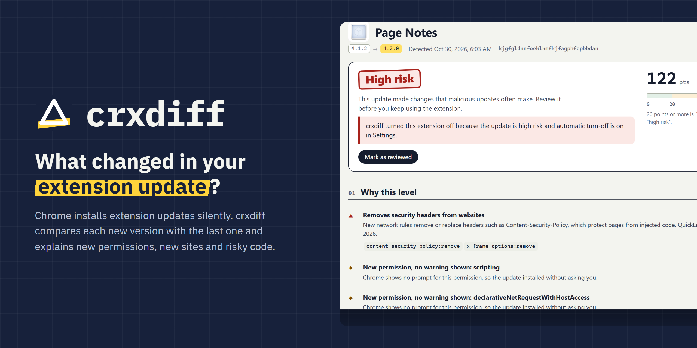
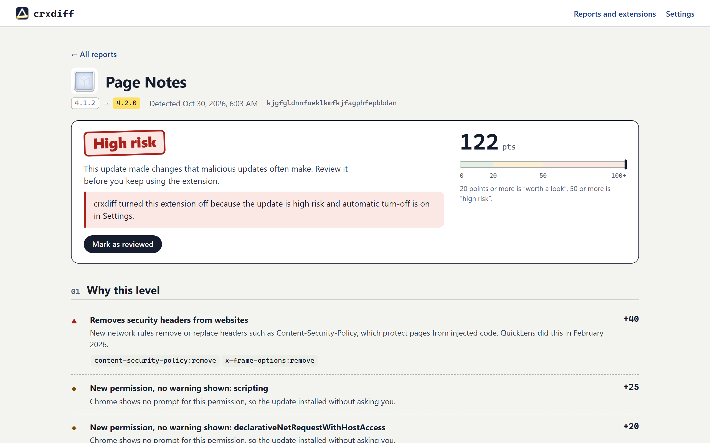
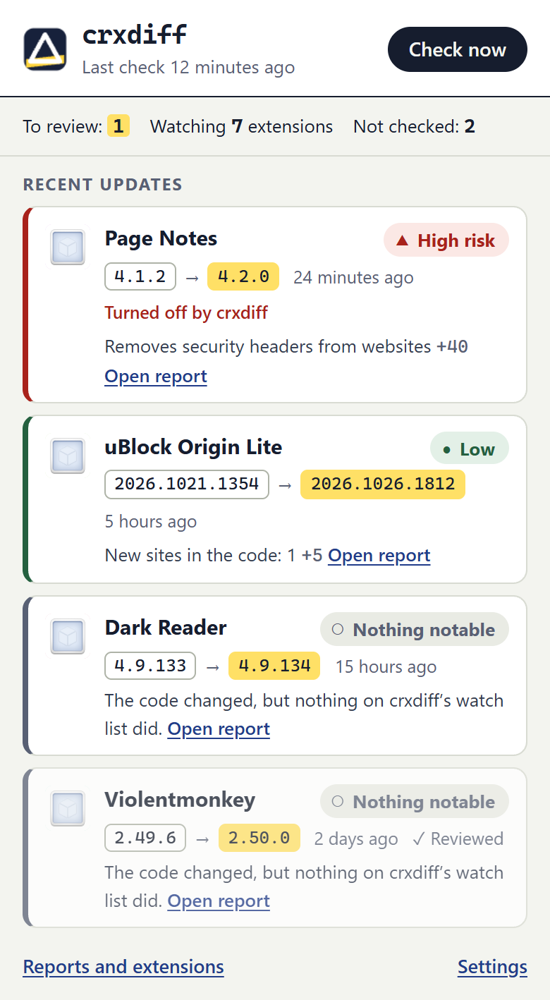
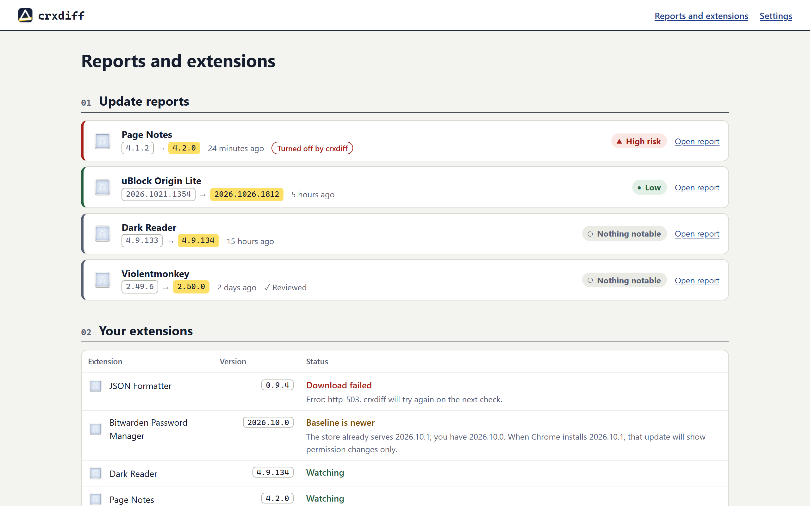

<p align="center">
  
</p>

<p align="center">
  <a href="https://github.com/yahyakhalid/crxdiff/actions/workflows/ci.yml"></a>
  <a href="LICENSE"></a>
  
  
</p>

<p align="center"><b>English</b> · <a href="README.ar.md">العربية</a></p>

<p align="center">
  <a href="https://github.com/topics/chrome-extension"><code>#chrome-extension</code></a>
  <a href="https://github.com/topics/browser-extension"><code>#browser-extension</code></a>
  <a href="https://github.com/topics/manifest-v3"><code>#manifest-v3</code></a>
  <a href="https://github.com/topics/supply-chain-security"><code>#supply-chain-security</code></a>
  <a href="https://github.com/topics/security"><code>#security</code></a>
  <a href="https://github.com/topics/privacy"><code>#privacy</code></a>
  <a href="https://github.com/topics/malware-detection"><code>#malware-detection</code></a>
  <a href="https://github.com/topics/diff"><code>#diff</code></a>
  <a href="https://github.com/topics/crx"><code>#crx</code></a>
  <a href="https://github.com/topics/permissions"><code>#permissions</code></a>
  <a href="https://github.com/topics/local-first"><code>#local-first</code></a>
  <a href="https://github.com/topics/rtl"><code>#rtl</code></a>
  <a href="https://github.com/topics/arabic"><code>#arabic</code></a>
</p>

# crxdiff

**What changed in this update? crxdiff tells you, for every Chrome extension you have installed: new permissions (including the ones Chrome never warns about), new sites in the code, removed security headers, risky code, all compared on your device.**

## The problem

Chrome extensions update themselves, silently. Chrome only stops an update when it adds a permission that shows a [permission warning](https://developer.chrome.com/docs/extensions/develop/concepts/permission-warnings): then "the extension will be disabled until the user accepts the new permission". Anything else, including new code inside permissions the extension already had, installs without a word.

That is how most of the recent incidents reached people:

- **Cyberhaven, December 2024.** A developer account was phished and a malicious version 24.10.4 was published; the same campaign hit many other extensions ([RH-ISAC](https://rhisac.org/threat-intelligence/cyberhaven-extension-compromise-part-of-broader-campaign-affecting-multiple-chrome-extensions/)).
- **RedDirection, July 2025.** 18 extensions with more than 2.3 million users, some verified or featured, received their malicious code in later updates ([Infosecurity Magazine](https://www.infosecurity-magazine.com/news/18-malicious-chrome-edge-extensions/)).
- **ShadyPanda, late 2025.** Extensions that had behaved since 2018 got an update in mid-2024 that loaded arbitrary JavaScript every hour; about 4.3 million users in total ([Infosecurity Magazine](https://infosecurity-magazine.com/news/shadypanda-infects-43m-chrome-edge)).
- **QuickLens, February 2026.** Put up for sale, changed owner, then shipped an update that stripped security headers and loaded remote JavaScript every five minutes ([The Hacker News](https://thehackernews.com/2026/03/chrome-extension-turns-malicious-after.html)).
- **"Save image as Type", early 2026.** Over a million users and a Featured badge; after an ownership change it hijacked affiliate links ([PCWorld](https://www.pcworld.com/article/3092299/my-most-useful-chrome-extension-was-stealing-my-data-for-years.html)).
- **JSON Formatter, 2026.** Went closed source and started injecting a donation widget into checkout pages and calling new servers; the write-up itself says the evidence of fraud is not conclusive ([DEV](https://dev.to/pavkode/json-formatter-extension-turns-closed-source-introduces-intrusive-donation-tactics-and-tracking-kf8)).

Each of these was an update the user never saw.

## Who it's for

- **People with more than a handful of extensions** who want to know when one of them changes in a way that matters.
- **Developers and IT staff in small teams** who can't justify an enterprise extension-security platform but want more than "it updated".

## What it does

| | |
|---|---|
| **Baseline** | On first run, downloads each installed Web Store extension from Google's update server and keeps a summary: manifest, file sizes and SHA-256 hashes, hosts named in the code, risky patterns. Not the source code. |
| **Update detection** | Listens to `chrome.management.onInstalled` and also polls every 1 to 24 hours, so an update is caught even if the event is missed. |
| **"What changed" report** | New and removed permissions (marked when Chrome shows no warning for them), new host access and content-script sites, CSP changes, new sites in the code, newly used `eval` / `new Function` / remote scripts / `executeScript`, rules that strip `Content-Security-Policy` or `X-Frame-Options`, new obfuscated or WebAssembly files, ZIP tricks, size jumps, changed update URL, homepage or author. Plus a file-by-file list and a `manifest.json` diff. |
| **Explainable score** | Every finding has its own points and a plain-language reason. 20+ points is "worth a look", 50+ is "high risk". |
| **Optional auto-disable** | Turns off an extension whose update is high risk, with one click to turn it back on. Off by default. |
| **Bilingual** | English and Arabic, with a full right-to-left layout. |
| **Local only** | No server, no account, no analytics. The only network requests go to Google's update servers, for extensions you already have. |

## Screenshots

Real extension pages in Chrome for Testing. The data is simulated: "Page Notes" is a made-up extension from [`test/fixtures`](test/fixtures) whose 4.2.0 imitates QuickLens; the other reports are real diffs between consecutive public releases.

<p align="center"></p>

<p align="center">
  
</p>

<p align="center"></p>

## Install

crxdiff is not on the Chrome Web Store yet (a link will be added here once it is).

1. Download `crxdiff-0.1.0.zip` from the [latest release](https://github.com/yahyakhalid/crxdiff/releases) and unzip it, or build it yourself (below).
2. Open `chrome://extensions`, turn on **Developer mode**, click **Load unpacked** and pick the unzipped folder.
3. crxdiff takes its first baselines right away. Open its toolbar popup to see the status.

Build from source (Node.js 20 or newer):

```bash
git clone https://github.com/yahyakhalid/crxdiff
cd crxdiff
npm ci
npm run check     # lint, tests, then dist/crxdiff-0.1.0.zip
```

The build is deterministic: the same source gives the same zip, byte for byte.

## How it works

1. **List.** `chrome.management.getAll()` gives every installed extension, its version and how it was installed. Unpacked, policy-installed, Edge-store and self-hosted items are listed as "not checked", with the reason.
2. **Download.** `https://clients2.google.com/service/update2/crx?response=redirect&…` returns the current package, redirected to `clients2.googleusercontent.com`. crxdiff checks that the CRX3 header's `crx_id` is the extension it asked for.
3. **Unpack, carefully.** Its own ZIP reader enforces limits before allocating anything (entries, per-file and total size, compression ratio), inflates in 8 KB steps with the vendored [fflate](https://github.com/101arrowz/fflate) decoder and stops a stream the moment it exceeds its declared size. Nothing is written to disk or executed.
4. **Summarise.** SHA-256 of every file; hosts from absolute URLs in scripts and pages; a list of risky patterns; static `declarativeNetRequest` rules that touch security headers; shape checks for minified and obfuscated code. All scanners are linear-time.
5. **Compare.** The new summary is compared with the baseline (`src/lib/diff.js`), each finding gets points (`src/lib/risk.js`), and the report is stored locally.
6. **Tell you.** Badge count for unreviewed reports that are worth a look or high risk, an optional notification, and auto-disable if you turned it on.

The store serves only the newest version, so the first baseline might not match what you have installed. crxdiff records that honestly: a baseline newer than your version is kept (and the next update is shown as "permissions only"), an older one is discarded and retried. If a new package can't be analysed (too big, malformed, too slow), the update is reported as high risk instead of being skipped.

The engine is plain ES modules with no browser APIs, so it runs in Node too:

```bash
node scripts/compare.mjs old.crx new.crx          # or .zip
```

## Privacy

- No data leaves your browser except the download requests to `clients2.google.com` and `clients2.googleusercontent.com`, which contain the extension ID and your Chrome version, the same request Chrome itself makes for updates.
- Baselines and reports are kept in `chrome.storage.local`. Settings has an export (JSON) and a delete-everything button.
- No analytics, no telemetry, no remote code. The extension's CSP only allows its own scripts and only connects to the two update hosts.

Full policy: [PRIVACY.md](PRIVACY.md).

### Permissions

| Permission | Why |
|---|---|
| `management` | To list your extensions and their versions, notice updates, and turn an extension off (only if you enable auto-disable) or back on. |
| `storage` | To keep baselines, reports and settings on your device. |
| `alarms` | To check for updates on a schedule (every 1 to 24 hours). |
| `notifications` | To tell you about an update that is worth a look (can be turned off). |
| `https://clients2.google.com/*`, `https://clients2.googleusercontent.com/*` | To download the packages of extensions you already have, from Google's update server. |

`unlimitedStorage` is not requested: real summaries are small (uBlock Origin Lite, the largest tested, is about 250 KB), and a package built to fill storage is refused.

## How it compares

| | Looks at code changes | Warning-free permissions | Runs locally | For | Status (2026-10-29) |
|---|---|---|---|---|---|
| **crxdiff** | ✅ summary + file list + manifest diff | ✅ | ✅ | anyone with extensions | experimental 0.1 |
| [ext-watcher](https://github.com/ading2210/ext-watcher) | ✅ full diff, with deobfuscation | via the diff | ✅ (your machine or server) | developers: a Python script for a list of IDs; posts diffs to Discord webhooks | open source (AGPL-3.0) |
| [Under New Management](https://github.com/classvsoftware/under-new-management) | ❌ owner changes only | ❌ | ❌ uses an external API | anyone | no update in about two years ([Android Authority](https://www.androidauthority.com/chrome-extension-under-new-management-3650500/)) |
| [Extensions Update Tracker](https://github.com/maximtop/extensions-update-tracker) | ❌ version log | ❌ | ✅ | anyone | open source |
| [CRX Viewer](https://github.com/Rob--W/crxviewer) | ❌ views one version | ❌ | ✅ | developers | open source |
| Secure Annex (Socket), Spin.ai, LayerX, Koi | ✅ | ✅ | ❌ cloud | companies | paid |

**ext-watcher is the closest functional alternative**: it already downloads new versions of the IDs you list, deobfuscates them and produces diffs. If you are comfortable running a Python job and reading code diffs, it shows more of the code than crxdiff does. crxdiff's difference is that it lives in the browser, watches what is actually installed, explains the change in plain language with a score, and can turn an extension off.

## Verified results

Measured on 2026-10-30 (Windows 11, Node 26, Chrome for Testing 156.0.8078.80). How to re-run each one is in [docs/experiment.md](docs/experiment.md).

| Check | Result |
|---|---|
| Download + parse inside the extension service worker, 4 real Web Store IDs | 4/4, `crx_id` matched every time, no CORS problem |
| `management.onInstalled` fires when another extension updates | yes, 7 to 8 ms after the update (unpacked reload; a real store update was not testable) |
| Routine updates: 26 consecutive real releases of 6 popular extensions | 24 "nothing notable", 2 "low" (5 points), 0 "worth a look", 0 "high" |
| Simulated QuickLens-style update (`test/fixtures/page-notes-4.2.0`) | high risk, 122 points |
| Analysis time in the service worker | 53 ms (Dark Reader) to 1.3 s (Bitwarden, 26 MB) |
| Unit and regression tests | 60 passing (`npm test`) |
| Store zip | `dist/crxdiff-0.1.0.zip`, 29 files, reproducible |

## Limitations

- **Experimental (0.1).** Scores and thresholds will change as more real updates are seen.
- **It detects after the update has installed.** Chrome installs first; crxdiff reports afterwards (usually within minutes of the event, at most one polling interval later). It is a detector, not a blocker, except through the optional auto-disable.
- **Obfuscated or very large code limits what it can see.** It flags obfuscation and unreadable files, but it can't tell what an obfuscated script does, and a host built at run time (`'ht'+'tps://'…`) isn't found by text scanning.
- **Only Chrome Web Store extensions.** Edge-store, unpacked, policy-installed and self-hosted extensions are listed as not checked.
- **The first update after install may be "permissions only"** if the store had already moved on when the baseline was taken.
- **A real store update firing `management.onInstalled` is not verified** (only an unpacked reload was); the polling fallback covers it either way.
- **"Sites named in the code" is not network traffic.** A name in the code doesn't prove the extension contacts it, and code can contact sites it never names.

## Roadmap

- Firefox (AMO) and Microsoft Edge Add-ons support.
- Show the full text diff for changed scripts (with beautified minified code).
- Community-maintained allow-lists for known-benign sites per extension, to cut "low" noise further.
- Package `scripts/compare.mjs` as a CLI for CI pipelines of extension developers.

## Contributing

Reports of false alarms and missed changes help most; please attach the extension ID and the two versions. See [CONTRIBUTING.md](CONTRIBUTING.md). Security issues: [SECURITY.md](SECURITY.md).

## License

[MIT](LICENSE) © Yahya Khalid. Includes [fflate](https://github.com/101arrowz/fflate) (MIT).
